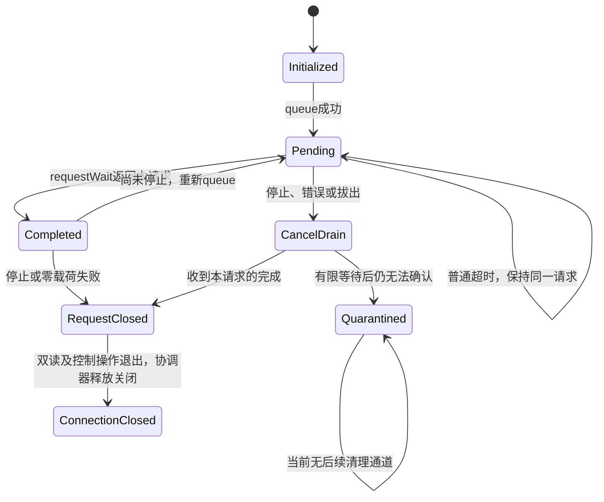

# USB物理拔出时异步请求回收调查与修正设计（007-U）

> 007-F归档（2026-11-02）：本文件为历史调查/实现记录，不再推进其中待建议的物理拔出修复。USB-001为Deferred，保留现有隔离及Strict；最终验收见[007归档](TOURBOX_INPUT_ACCEPTANCE_007_FINAL.md)，恢复建议以[已知问题](KNOWN_ISSUES.md)为准。

2026-11-01。状态：007-U分析完成；007-V获批实施方案1+2，实施记录见第9节。007-U当轮不修改代码、不构建或安装APK、不访问USB，不发送初始化/恢复命令；007-V代码实施另见第9节。当前minSdk=26、target/compileSdk=37；手机实际Android内核和OEM实现版本本轮未读取，不据targetSdk推定。

## 1. 007-T异常证据

来源为[007-T验收报告](TOURBOX_INPUT_ACCEPTANCE_007T.md)及此前电脑导出日志分析，不重新访问手机。327行22:46:09.371：requestWait为null或非预期请求（日志合并描述，无法区分）；328行cancel=false；329–331行未确认回收、两读任务退出、async安全回收=false并隔离；335行22:46:09.400拔出广播；336–337行重复隔离提示。I/O异常早于广播约29ms。

已确认语义140/140对应、无旧事件继续分发的可见记录、配置只发送一次，按钮及旋转接收正常。问题限于拔出回收，不将其归因于输入解码或94字节内容。**cancel=false不证明泄漏；线程退出只证明应用线程不再执行，不证明内核请求已回收。**

## 2. 当前异步请求状态机

源码位置按当前工作区：

- `DualEndpointSession.kt:108–185 readInterrupt`：UsbRequest初始化、direct buffer=8；queue成功才pending=true；单一0x81线程调用requestWait(200)。普通TimeoutException保留同一排队请求，不重复queue。
- requestWait返回本请求：pending=false，读取正长度载荷并再次queue；零载荷走失败，但已经取回本请求。null或其他对象：fail并保留pending=true。
- finally中pending=true时cancel一次，不因false立即释放；最多5次requestWait(200)，只有返回本请求才清pending。停止竞态中取回的正载荷仍记录。
- pending=false时request.close；仍pending则保留request/buffer，safeToClose=false。run:48–74等待两个读取线程退出才返回；native不遵守超时可能导致join长期等待。
- `TourBoxUsbManager.kt:421–445`：run返回false保存unsafeSession及静态quarantined Pair(connection, session)。closeInternal在隔离分支返回，故意不release/close；正常分支才逆序释放接口并关闭连接。
- `MainActivity.kt:84–94`拔出广播、refresh及后台调用Manager.close；close:257起只是失效epoch和排队清理，未直接从UI关闭native连接。



### 隔离路径的实际影响

1. 这是主动安全保留，不是遗忘调用close；但连接对象/请求/direct buffer可能长期保留。静态Pair还引用session及其回调，可能间接保留旧Manager/Activity，保留量不只8字节缓冲。
2. 隔离时connectedName/connectedDevice/dualClaims尚未清空，逻辑UI可能仍显示旧连接；广播+refresh+finally可重复触发清理提示，但隔离分支每次都提前返回，不是多次native close。
3. 原会话epoch、输入end及session.failed阻止旧事件/控制继续；静态quarantined在Activity重建后仍阻止新open。旋转或重新进入Activity不等于进程重启，提示“重启应用”目前容易歧义。
4. 当前日志确认两个读线程已退出，不能据静态保留声称读线程仍存活；协调器可空闲到Activity销毁。若native忽略有限超时，另有线程阻塞风险，未在本轮证明发生。
5. 只有finally中的一次cancel+5次等待；隔离后没有定时重试、detach后接力回收或清除注册表机制。重复close不会重试回收。
6. 单Manager串行且隔离后禁止open，倾向形成有限保留而非每次拔插无限增长；但静态字段非全局open预留锁，不能从注释证明所有多Activity并发下最多一个资源持有者。没有FD/内存测量，不能判定实际泄漏量，也不能承诺不会累积。保留static与JNI/内核资源是否已释放需分别观测。

## 3. 竞态及根因候选

| 候选 | 证据/可能性 | 未确认部分 |
|---|---|---|
|物理拔出先让wait/cancel失败，广播稍后到|29ms时差及设备消失支持，最符合现象|不能确认当次wait到底null还是另一对象，也没有errno|
|请求已完成或正完成，cancel已无可取消项|可以解释false；若之后取回原请求应可正常回收|本次5次等待未取回，不能把它直接判作已完成|
|设备/连接已失效，native取消失败|公开bool不含原因，需具体实现及记录|Java连接对象仍在不代表底层设备有效|
|其他异步消费者抢走完成或重复queue|理论会造成身份不符|现代码只有一个异步wait消费者，BULK同步读取不消费UsbRequest完成；未找到直接证据|
|应用并发close或重复close|一般生命周期风险|现协调器等待读线程，UI只排队，未见本次并发native close证据|
|回收预算/状态表示不充分|5次按次数等待；null可立即返回，故不等于等满1秒。bool混合多种终态|加长等待不保证修复设备失效后的持续错误|

权限失效与设备消失目前由devicePresent回调合成一个false。**权限被撤销不等于物理拔出**，不能作为专用detach释放条件。地址/设备名可能复用，迟到广播也不能无条件作用于新连接。

## 4. Android API保证与未知事项

### 公共契约（优先级高于实现推测）

- minSdk26覆盖queue(ByteBuffer)和requestWait(long)，不必用API26已弃用的queue(buffer,length)。queue成功后缓冲状态在请求返回前不可依赖；成功位置反映实际传输量。cancel只报告是否取消成功，未给出失败分类。[UsbRequest官方文档](https://developer.android.com/reference/android/hardware/usb/UsbRequest)
- requestWait(long)返回完成请求，错误时为null，超时为TimeoutException；可能返回该连接其他端点的异步请求。不能把null当普通超时，也不能把cancel真假当已dequeue证据。[UsbDeviceConnection官方文档](https://developer.android.com/reference/android/hardware/usb/UsbDeviceConnection)
- 官方Host指南要求通信结束或拔出时释放接口并关闭连接；这是清理目标，没有给出“pending身份未知时如何原子确认内核不再引用缓冲”的证明。[USB Host终止通信说明](https://developer.android.com/develop/connectivity/usb/host#terminating-communication-with-a-device)

### AOSP源码线索（不是小米系统保证）

本轮阅读AOSP main的Java源码：UsbRequest blob `beb0f8d336d5e6d6866eade80dfc50e83c2b6b7d`，UsbDeviceConnection blob `44144d92f56a46f8f56958f7f5a17387991c2517`。路径是上游快照，不表示设备内同版本。

- [UsbRequest.java](https://android.googlesource.com/platform/frameworks/base/+/refs/heads/main/core/java/android/hardware/usb/UsbRequest.java)：cancel可因无connection、native context无效、connection未open或native取消失败返回false；源码存在取消与connection close同步以避免use-after-free的说明。不能推定旧API/OEM完全相同，也不能枚举厂商所有失败路径。
- [UsbDeviceConnection.java](https://android.googlesource.com/platform/frameworks/base/+/refs/heads/main/core/java/android/hardware/usb/UsbDeviceConnection.java)：close有自身锁，requestWait取得native结果再dequeue；没有公共保证允许应用以并发close作为唤醒wait的通用手段。close后的对象不可重用，需要重新open。
- AOSP镜像[UsbRequest JNI](https://github.com/aosp-mirror/platform_frameworks_base/blob/master/core/jni/android_hardware_UsbRequest.cpp)的native_close调用request_free；[libusbhost](https://github.com/aosp-mirror/platform_system_core/blob/master/libusbhost/usbhost.c):674–728的free、wait、cancel分离，取消走DISCARDURB，等待错误可返回空，free不是“自动cancel+完整drain”。[连接JNI](https://github.com/aosp-mirror/platform_frameworks_base/blob/master/core/jni/android_hardware_UsbDeviceConnection.cpp):63起关闭底层device。以上master镜像为实现示例，未与Java main拼接当作手机完整实现，也未核实其内核/厂商补丁。

因此：getFileDescriptor>=0不证明设备仍连接；deviceList缺失、广播、线程join也各自不证明native请求完成。拔出时的顺序、错误、回收可见性及close是否同步清除全部pending引用依赖具体栈。本轮不能证明“先connection.close再request.close”在所有目标版本安全，不能据通用指南放宽保护。

## 5. 修复方案比较

| 方案 | 改动与收益 | 风险/不足 | 建议 |
|---|---|---|---|
|1 保持隔离，仅改善判断/日志|拆分null、foreign、timeout、detach、权限；结构化结果代替bool，UI区分逻辑断开与持有资源|不会单独恢复再次连接，也不能保证回收|作为最小第一步|
|2 单一owner取消、有限drain和关闭交接|读任务原owner先cancel/drain；线程及控制操作退出后，仅协调器接管未完成对象，匹配detach时有限一次补充drain；明确幂等close|不是简单“多等一点”；可能仍持续null，必须保留隔离；需防双wait/地址复用|与1组合推荐|
|3 已物理断开专用失效连接释放|在身份匹配detach、全部应用I/O退出后尝试terminal cleanup，潜在解除永久阻塞|公共API未证明pending未知时free安全；close顺序/JNI引用/OEM差异仍未知|保留为后续受控验证分支，本轮不建议直接启用|

不推荐：null/cancel=false直接当回收成功；join后无条件request.close；wait阻塞时从UI强行connection.close；删除static保护以便再次open；关闭0x81监听规避；无限循环/无限重试；反射读取私有native字段。这些都没有足够依据。

## 6. 推荐的最小修改（待批准）

**建议先实施1+2的状态与有限回收交接，不把“物理拔出即强制释放未知pending”作为默认修复。** 这是安全性/可诊断性改进，可能回收迟到完成，但不能承诺本设备持续null情形必然解除隔离；若仍未知，需要方案3的额外平台证据与单独批准。不能把第一步包装成已解决FD释放问题。

### 文件与职责

- 新增纯状态类（建议`UsbAsyncCleanupState.kt`）及可注入的小型RequestIo接口：区分NotQueued、Pending、CompletionRetrieved、CleanupUnconfirmed、Closed及停止原因；不引入USB驱动库。
- `DualEndpointSession.kt`：拆开null与foreign对象日志；保存pending/完成身份、cancel结果、每次wait结果/耗时、request-close结果，返回结构化SessionResult，保留请求及buffer的明确所有权。读取期间仍只有原0x81线程wait，超时不重复queue，正载荷仍原样记录。
- `TourBoxUsbManager.kt`：唯一清理协调器，session级close-once/CAS；接管前必须两个读线程和正在执行控制/OUT动作都结束，原owner不再wait。接管后新动作全部禁止，只允许一次有限回收观察，不再queue、不发送控制或私有命令。
- `MainActivity.kt`：detach通知携带观察到的device身份及当时绑定的会话快照进入协调器，不直接close。首次缺失可标suspected，匹配广播可标confirmed；把权限变化单列。UI显示“已断开/回收未知”，不仍显示连接可用。
- 隔离记录避免保存整Activity回调链，只保留回收所需资源及不可变诊断元数据。仍未知保留进程级有界隔离；所有新open经同一所有权检查。若需要支持多Activity并行，补process级owner预留或明确禁止并行，不能只依赖volatile Pair。
- 测试文件及现有Gradle无设备测试入口：扩展假实现状态与调度，不改命令常量、CDC参数、0x81/0x82/0x02、007事件模型或初始化手动顺序。

### 建议状态转换与时限

1. 正常：Pending→StopRequested→CancelAttempted→Drain（cancel真假均继续识别完成）→CompletionRetrieved→RequestClosed；双读和控制操作结束后release接口、connection.close。无pending的初始化/queue失败直接按未排队关闭路径。
2. null/foreign/设备消失：停止语义和控制资格，记录精确原因，禁止新queue；不要立即凭null清pending。单owner按原预算最多5次200ms等待，记录实际elapsed而不谎称一定等满1秒；即时错误避免忙转（短退避，仍有次数和单调时限上限）。
3. 未drain：交出请求与buffer→ReadTasksJoined→CleanupUnconfirmed；协调器拿到唯一所有权。在收到**匹配同一旧会话**的detach后最多再做一轮有限drain，建议上限5次/总1秒，包含退避，不重复cancel；只观察完成队列，不重发协议。迟到请求取回后才正常关闭request及连接并清隔离。
4. 仍null/错误、身份不符或时限到：Quarantined，记录未解决。不得直接记“完成”；不允许同进程再open以无限增加资源。系统调用不遵守时限时，不并发free，记录hang并保持隔离；不能承诺硬性超时强制终止native。
5. confirmed-detach不自动转换Completed，只影响原因分类与允许有限回收机会。若对象曾经close，任何晚到cancel/wait/release都拒绝；重复通知幂等。
6. 地址复用：所有异步任务捕获会话epoch和connection引用；broadcast本身不携带app epoch，要结合当前列表/保留旧连接记录判定，不能仅凭VID/PID或deviceName关闭新设备。有歧义宁可隔离，不误伤新会话。

request.close本身异常目前仅log，safeToClose未单独反映该失败；建议结构化结果区分“请求已取回但关闭失败”与“仍可能pending”，不把两类都模糊成安全成功/失败。接口release失败也应记录，但在已确认无在途请求后可继续尝试connection.close，绝不伪报成功。

## 7. 单元测试及真机回归设计

### 无设备测试（此轮仅设计，未新增或执行）

用脚本化fake RequestIo、可控时钟和执行器记录queue/wait/cancel/request-close/release/connection-close的调用顺序及inFlight计数，不依赖Android内核。保留现有007输入200项及Config94回归；项目外旧SessionCheck夹具覆盖双读进展、queue失败、未回收隔离，但没有完整物理detach/foreign/null身份分类，不能当本修复验证。

| 场景 | 必须断言 |
|---|---|
|正常停止|cancel/drain原请求，request关闭后协调器释放；connection仅关一次|
|突然拔出、广播早/晚|原因分类正确、I/O停止，无并发close；未确认时保留，不冒充成功|
|requestWait=null|不作为timeout或完成；真实null与foreign日志不同|
|cancel=false后取回原请求|照常drain关闭，不因false错误隔离|
|cancel=false且持续null|次数/预算有界，最终未知隔离，不free pending、不自动重连|
|cancel=true但未取回|也不能当已drain，保留未知|
|完成与停止并发|完成载荷原样保留；只一次队列消费、不重复queue或close|
|重复detach/close/后台|资源身份锁定，cancel/最终close按设计幂等，无第二个wait消费者|
|旧回调/同地址重连|旧epoch语义和控制拒绝；旧广播不无条件关闭新连接|
|清理异常|wait、request-close、release、connection-close分别注入异常，结果分级，不丢资源所有权|
|迟到完成交接|确认旧线程退出后协调器才wait，取回后清隔离；前后无并发wait|
|native不返回|模型标记无法join，禁止free；不声称纯fake证明真实native限时|
|资源有界|隔离后不再open；多Manager并发不覆盖既有持有者；析构不依赖GC|

### 真机回归（实现、构建及用户安装/测试授权后）

1. 记录系统/应用版本、基线线程/FD数量（仅权限允许的只读统计，拒绝则报告，不绕过）。不输出设备敏感信息。
2. 用户手动完成原双接口初始化、八字节/26字节/94字节，确认按钮及四方向；不变协议，不自动发送。
3. 标记正常停止，确认请求结果、双方任务退出、release和close；正常路径不能回归。
4. 新会话重新连接并同样手动初始化，标记“即将物理拔出”；直接拔出，前台等待至少5秒，记录结束标记。
5. 检查null/foreign、cancel、每次drain、线程join、是否回收或隔离；不能只看“线程退出”。
6. 仅清理已确认完成并解除隔离后允许用户再次连接/初始化，检查旧事件无效、新事件正常。若仍隔离，本轮失败/受限，停止，不强开第二个连接或反复尝试。
7. 正常停/拔出分别至少5轮（建议10轮），每轮留完整日志。相同静置状态比较FD/线程/内存趋势，允许runtime噪声，不能仅凭一次内存上升认定泄漏。任一轮未知pending不得通过清除标志继续压力测试。
8. 物理拔出releaseInterface返回false可由设备消失解释，但须区分接口已不可用与close是否完成；验收不能要求拔出后接口必然返回true，也不能因此跳过已无pending的连接关闭。

## 8. 风险、验收与执行范围

- 必须同时满足：不并发wait/queue/free/close；无pending重复queue；正常停止稳定；旧事件失效；能解释每次close结果；多轮无持续资源增长及可再次连接。若仍隔离，则故障安全可能通过，但“完整自动恢复”不通过。
- 方案1+2无法保证设备已移除后永远取得完成。公共API不够证明方案3安全时，明确留下阻塞条件，不以“设备已拔出所以一定无引用”填补。
- 本轮仅官方资料与AOSP源码阅读、项目/现有测试只读审查和文档格式检查。未获取手机新信息，未改Android或测试代码、未编译、未运行设备回归、未安装软件或提交Git。
- 原协议功能140/140结果保留，不简化成功流程。建议先批准状态/单owner有限回收设计；若用户要求必须无隔离重连，需要再审核目标平台terminal cleanup证据及策略，不能默认放行强制回收。


## 9. 007-V实施记录（方案1+2）

本节记录代码实现，前文007-U是历史调查。没有启用方案3，没有任何“拔出后强制free未知pending”的路径。未连接ADB、访问USB、安装/启动APK或发送命令；不据模拟测试声称真机拔出已修复。

### 状态、所有权与资源

- `UsbAsyncCleanupState.kt`纯JVM策略区分NotQueued、Pending、CompletionRetrieved、CleanupUnconfirmed、Closed、Quarantined；停止原因与最后drain观察原因分开，区分null、foreign、Timeout、权限、未确认缺失、已确认拔出及I/O异常。Closed仅描述请求，连接是否关闭另有明确日志，不能互相替代。
- `UsbRequestResources.kt`封装原UsbRequest/direct buffer/connection及RequestIo适配器。读取期间只有0x81线程调用requestWait；进入native queue前保守预留Pending；明确返回false才改回NotQueued，异常则保持可能在途，禁止直接free。普通超时保持同一Pending，不重复queue。只有wait返回原对象才completed，cancel真假均不是证明。
- 原读取线程最多cancel一次，然后最多5次wait，每次不超过200ms，单调观察预算1000ms；即时失败短退避20ms，全部计入预算。异常、null、其他请求分别记录。正长度停止竞态载荷依然完整记录，不重新解释事件。
- 请求未排队或已取回才允许request.close；只尝试一次。close异常单独记录并隔离，不当作仍pending，也不再次cancel/free。原线程finally标记readerFinished，协调器实际join两个读取任务、退出最后控制操作后，才执行一次所有权交接。状态接口同时检查当前owner身份、readerFinished及交接次数；不保存Thread对象。
- 协调器匹配物理拔出证据后，对原先未取回请求最多补充一轮同样5次/1000ms观察：不queue、不cancel、不发送任何命令。只有取得原请求才记录可能的原始0x81载荷、close请求、逆序release接口、close连接。未取回继续隔离；重复广播/close不会启动第二轮。
- `ExclusiveUsbLease`在openDevice之前进程级串行预留唯一token，多Manager无法覆盖现有连接/隔离记录。正常关闭后释放token；旧token无法释放新所有者。连接关闭也有单次保护；release异常不妨碍已无pending时尝试close，close异常保留记录，不重试或伪报成功。
- 静态隔离只保存`UsbConnectionResources`（connection、接口、request/buffer、状态及不可变身份），不保存DualEndpointSession、Manager、Activity、executor或日志回调。回收时临时传入日志，不静态持有回调链。native若长期不返回，仍可能通过实际工作线程保留会话，不能用另一线程free来强行切断。

### 拔出证据与逻辑断开

MainActivity传递detach设备给Manager；不再仅凭connectedName调用close。记录捕获时的连接token、设备地址和ID，并核对枚举缺失。广播不包含应用epoch：地址仍存在、旧token、设备身份不符均不授予补充回收资格。**同一进程内复用过的地址也保守视为代次有歧义**，即使设备后来消失，也只逻辑断开，不自动认定旧广播属于新会话。该保护可能减少可自动恢复的情形，不能靠VID/PID或同名放宽。

明确close或首次读取故障会先撤销语义epoch和控制资格、清connectedName，UI显示“已逻辑断开；等待回收结果”；完成后区分“资源回收完成”和“回收状态未知（隔离）”。设备缺失/地址复用的逻辑停止由当前枚举缺失佐证，不把迟到广播当新会话的补充回收授权。拔出回调只标记捕获的Identity逻辑失效，事件有效性检查及读任务取消立即观察该标记；不凭旧UI快照直接递增全局epoch。排入协调器的清理再次核对Identity对象，防止迟到通知误停新会话。所有USB资源操作仍只在原owner或唯一协调器执行，不在广播/UI线程释放。

晚到的匹配detach可通过同一Manager的保留身份进入worker补充回收。Activity销毁且receiver注销后，不建立独立静态恢复线程；进程隔离继续保留，不能承诺重建Activity后自动恢复。若native忽略超时，join或wait可超出预算：预算限制的是正常返回API的调用次数/观察时长，不能硬终止native，不并发关闭其资源。

### 无设备测试与验证

新增`UsbAsyncCleanupCheck.java`和Gradle `:app:testUsbAsyncCleanup`，纳入check。脚本化RequestIo、单调时钟及连接关闭适配覆盖正常回收、广播先后顺序的状态/门控、null、foreign、cancel真假、持续错误、停止/完成竞态、重复queue/关闭、旧token/地址复用、关闭与release异常、join前拒绝交接、预算和多Manager租约。它们验证应用策略，不运行Android framework或真实USB广播/驱动，不等于平台并发行为已验证。原007输入与94字节配置回归保持不变。

验证记录：新增清理20个场景、105项断言及原输入200项断言通过；原Config94完整回归通过。第一次新增测试因无证据supplement检查顺序触发断言，修正为直接拒绝后重新通过；未以跳过测试方式处理。最终构建、Lint及签名结果见下文。复现命令（在android目录，使用既有JBR，不改系统环境）：

```powershell
$env:JAVA_HOME = 'G:\Program Files\Android\Android Studio\jbr'
.\gradlew.bat :app:testInputEvents :app:testConfig94 :app:testUsbAsyncCleanup :app:assembleDebug :app:lintDebug --offline --no-daemon --console=plain
```

### 下一步真机验收（待用户批准安装和操作）

1. 保留旧日志，用户批准后覆盖安装；不清除数据。用户手动执行原双claim、A1→A0→8字节→完整26字节→一次94字节；核对按钮和四方向语义事件。
2. 正常停止，核对cancel、原请求完成、request.close、双方线程join、release/connection.close及UI状态，不把cancel=true当完成。
3. 新会话重复原流程后标记“即将物理拔出”，拔出、前台等待至少5秒，再标记结束。核对null/foreign区分、每次drain、原owner退出、是否获得匹配detach资格及补充观察次数。
4. 只有确认完整回收并释放租约后才能再连接；正常停和物理拔出分别至少5轮，检查事件、线程/FD趋势。地址复用被拒绝补充回收应明确记录，不能清标志强行继续。
5. 若仍隔离或native调用不返回，停止该轮，保存日志；本修复的故障安全可以成立，但“物理拔出后完整自动恢复”仍不通过。不得用强制free、重发初始化或修改协议绕过。


最终验证：离线 :app:testInputEvents、:app:testConfig94、:app:testUsbAsyncCleanup、:app:assembleDebug、:app:lintDebug 全部成功（48项任务，16执行/32最新）；新增20个场景、105项断言和输入200项断言通过，配置回归通过。Lint 0错误/7警告：AndroidGradlePluginVersion 1、DataExtractionRules 1、SetTextI18n 5；界面状态改用列表拼接后较原9条减少2条，未屏蔽规则。git diff --check及新代码/测试空白检查通过；CdcAction.kt、UnlockCandidate.kt、Config94Experiment.kt与HEAD逐字节（统一换行）一致。APK签名检查通过；APK SHA256 A870A631938B51B16DF43BA3BFB8357D722339D27BD09BAE3078C84656B86F9B。apksigner有既有JDK未来native-access提示，不影响本次验证。未执行设备测试，无Git暂存/提交。


## 10. 007-Y连接代次修正

2026-11-02，获批实施007-X最小方案。第9节永久地址复用否决属于007-V历史实现，现由成功open记录、正常关闭收据及不可变观察替代。详见[007-Y实施与严格默认限制](USB_CONNECTION_GENERATION_REVIEW.md#9-007-y实施记录2026-11-02)。

进程级预留租约、未知pending隔离、单wait owner、原线程join后交接、一次有限补充观察、成功取回原request才关闭等规则保留。控制操作新增原连接引用核验；没有改变8/94字节、CDC、端点、输入事件及用户手动流程。

补充观察的结构化原因使用DetachCorrelated，避免将应用关联日志写成物理代次确证；生产Strict模式下裸系统广播仍Unknown，额外观察被拒绝。测试中的候选CorroboratedApplicationEvidence不是运行时放宽。native不返回、关闭异常、观察歧义等仍可能隔离，不承诺物理拔出自动恢复。

无设备验证结果见007-Y实施记录；真机效果未验证，未安装APK或访问ADB/USB。


007-Y最终检查：输入497断言、原配置回归、异步清理20场景/105断言、代次27场景/48断言通过；Debug构建/签名及格式通过，Lint 0错误/7既有警告。真实detach在Strict下Unknown，不宣称补充回收或自动恢复已真机通过。
